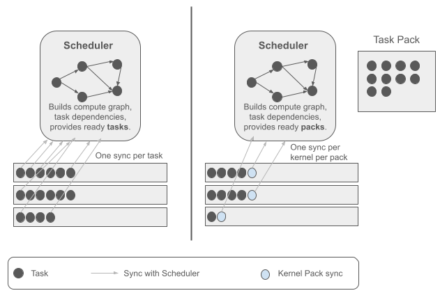
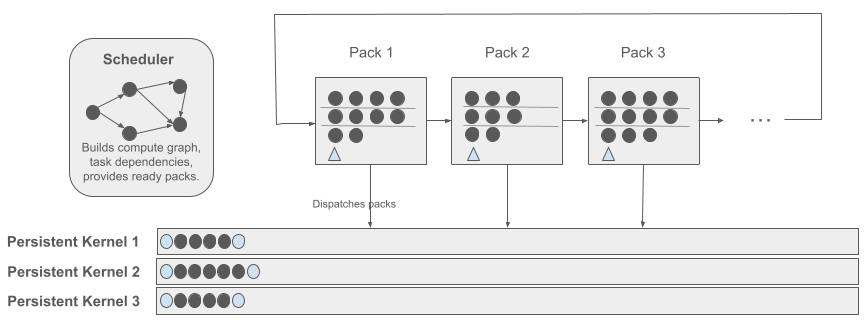
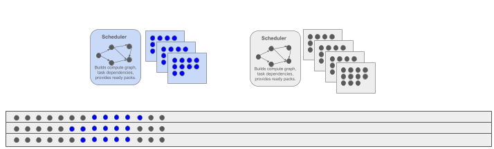
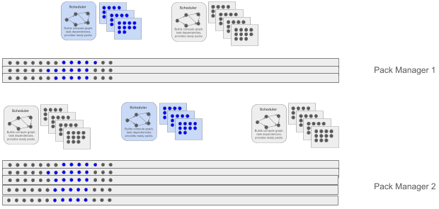
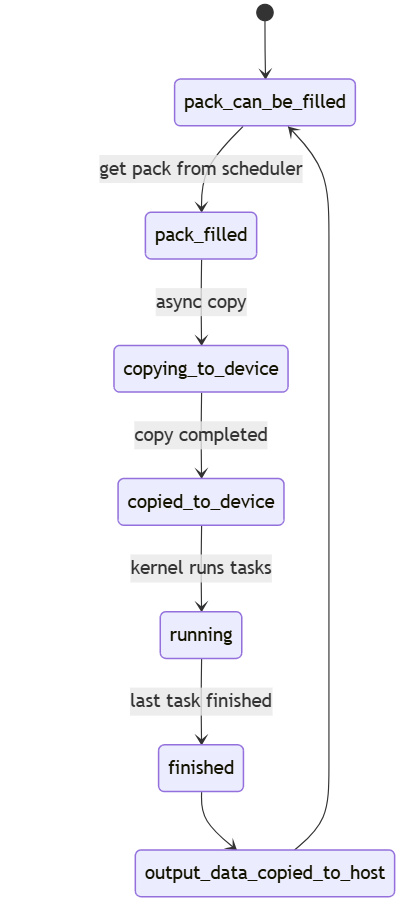

# TaskPack --- Ready-Task Pack Scheduling for Persistent GPU Execution

> 
> **Author:** Afshin Zafari
>
> **TL;DR:** Reducing scheduling and dependency-tracking
> overhead by handing execution kernels **packs** of tasks that are already
> ready to run.

------------------------------------------------------------------------

## Abstract
<p>
Large language model (LLM) inference relies on computational operations
that can often be divided into smaller units of work. General matrix
multiplication (GEMM), for example, can be tiled into many tasks, some
of which may be independent and ready to execute at the same time. A
runtime must still decide which work is ready, make it available to
execution resources, and coordinate progress.
</p>

**TaskPack** explores a simple change in the scheduling interface:
instead of scheduling every task individually, a scheduler provides a
*pack* of tasks whose dependencies have already been satisfied. The
execution side can then process the ready tasks without asking the
scheduler to establish readiness separately for every tile-task at
dispatch time (see Figure 1).

<figure style="text-align: center;">
  
  <figcaption><b>Figure 1. TaskPack changes the unit of work provision from individual ready tasks to a pack of ready tasks.</b></figcaption>
</figure>

This project is designed and created after necessity of kernel fusion and MegaKernels that tried to reduce the cost of launching many small GPU kernels. One family of solutions is based on persitent kernels where stream of tasks are fed into them to be executed. This project shows that the amount of synchronizations between host and deviec can be reduced by changing the granularity to *packs* rather than *tasks*.


This post introduces the motivation, the proposed design, the intended
benefits, the current limitations, and the experiments needed to
evaluate the approach. The reduction in scheduling overhead is a
hypothesis to measure, not a performance result assumed in advance.

------------------------------------------------------------------------

## 1. The problem: scheduling fine-grained work

LLM inference involves operations such as matrix multiplication and
attention. Some operations can be decomposed into many smaller tasks,
such as output tiles of a GEMM. Within a set of independent tiles, there
may be substantial parallel work available.

A scheduler has two related responsibilities:

1.  **Dependency management:** determine when a task's required inputs
    and predecessor tasks are complete.
2.  **Work provision:** make ready tasks available to the execution
    resources that can run them.

If the runtime tracks readiness and dispatches work at the granularity
of every individual tile-task, the bookkeeping and coordination may
become significant---especially when tasks are small and the amount of
computation per task is limited. The actual overhead depends on task
size, graph structure, scheduling policy, hardware, and implementation,
so it must be measured for the target workload.

TaskPack asks: **when many tasks are already known to be ready and
independent, can the runtime manage readiness at pack granularity and
hand the execution system a group of ready tasks?**

For example for a matrix multiplication of $$A_{1024\times 4096}\times B_{4096 \times 11008} \to C_{1024 \times 11008}$$, the $$A$$, $$B$$ and $$C$$ can be partitioned into tiles like $$\bar{A}_{16\times32}$$ and $$\bar{B}_{32\times 128}$$ and $$\bar{C}_{16\times 128}$$ and do the multiplication on tiles instead, where each task is computing tile-tile multplication. All the multiplications of $$\bar{A}_{ik} \times \bar{B}_{kj}$$ for $$\forall i = 1 \cdots 16$$ and $$\forall j = 1\cdots128$$ and a specific $$k$$ are independent and can be run in parallel. Then all tiles of $$\bar{C}_{16\times 128}$$ will be updated $$32$$ times iteratively. This means that there are $$32$$ packs, each containing $$16\times 128$$ independent tasks.


------------------------------------------------------------------------

## 2. The central idea: a pack of tasks that are ready to run

A **task pack** is a group of tasks that are all ready to execute when
the pack is provided to the execution system. In other words, the
scheduler has already established that the dependencies required by
those tasks have been satisfied.

This distinction matters. TaskPack is not a claim that dependencies
disappear from the whole computation graph. Dependencies still need to
be represented and respected wherever they exist. The proposed
optimization is to avoid repeating readiness tracking for each
individual task at the execution handoff when readiness can be resolved
before the pack is delivered.

At a high level, the flow is:

1.  The scheduler constructs or maintains a compute graph and its
    dependencies.
2.  It identifies tasks whose prerequisites are satisfied.
3.  It groups suitable ready tasks into a pack.
4.  The execution system receives the pack and distributes its tasks to
    available kernels or workers.
5.  Completion for *packs* instead of *individual tasks* is recorded, allowing the scheduler to make downstream
    tasks ready and produce later packs.


------------------------------------------------------------------------

## 3. Why focus on GEMM?

The initial focus is on general matrix multiplication (GEMM), a common
building block in LLM inference. A GEMM can be divided into tiles so
that separate tasks compute different output regions. For a suitably
chosen tiling and dependency model, many of those tasks can execute
independently.

For example, a matrix operation may be represented as $C = A \times B$, with
the output matrix divided into tiles. A task can be associated with one
output tile, subject to the chosen algorithm and accumulation strategy.
If a group of tile-tasks has all required inputs available and no
unresolved dependencies between its members, that group is a natural
candidate for a ready pack.

This makes GEMM a useful starting point for a scheduling PoC: it
provides a recognizable workload and a way to vary the number and
granularity of tasks. However, results for one GEMM configuration will
not automatically generalize to attention, normalization, reductions, or
complete LLM inference. Those workloads may have different dependencies,
memory behavior, and task sizes.

<figure style="text-align: center;">
<figcaption><b>Table 1:</b> Sample times for different number of tiles, comparing TaskPack and Task granularity.</figcaption>
<table>
  <thead>
    <tr>
      <th rowspan="2" style="text-align: center; vertical-align: middle;">No of tiles</th>
      <th colspan="2" style="text-align: center; vertical-align: middle;">Dep. Tracking Time (<i>ms</i>)</th>
      <th rowspan="2" style="text-align: center; vertical-align: middle;">Saved Time</th>
    </tr>
    <tr>
      <th style="text-align: center; vertical-align: middle;">per Task</th>
      <th style="text-align: center; vertical-align: middle;">per TaskPack</th>
    </tr>
  </thead>
  <tbody>
    <tr>
      <td style="text-align: center;">8 x 8</td>
      <td style="text-align: center;">2.7</td>
      <td style="text-align: center;">2.6</td>
      <td style="text-align: center;">3.7%</td>
    </tr>
    <tr>
      <td style="text-align: center;">16 x 16</td>
      <td style="text-align: center;">31.5</td>
      <td style="text-align: center;">20.7</td>
      <td style="text-align: center;">34.29%</td>
    </tr>
    <tr>
      <td style="text-align: center;">32 x 32</td>
      <td style="text-align: center;">742.6</td>
      <td style="text-align: center;">466.5</td>
      <td style="text-align: center;">37.18%</td>
    </tr>
    <tr>
      <td style="text-align: center;">64 x 64</td>
      <td style="text-align: center;">14208</td>
      <td style="text-align: center;">8144</td>
      <td style="text-align: center;">42.68%</td>
    </tr>
    <tr>
      <td style="text-align: center;">128 x 128</td>
      <td style="text-align: center;">208929</td>
      <td style="text-align: center;">145043</td>
      <td style="text-align: center;">30.58%</td>
    </tr>
  </tbody>
</table>
</figure>

## 4. Inspiration from megakernels and persistent kernels

TaskPack is inspired by megakernels and persistent GPU kernels. These
approaches motivate keeping work available to a running kernel or
combining execution responsibilities in ways that may reduce repeated
launch or coordination costs.

The key idea explored here is related but distinct: **the scheduler
provides ready packs, while the execution side consumes tasks from those
packs.** The goal is to reduce fine-grained scheduling and
dependency-management overhead, rather than to claim that every
operation must be fused into one kernel, though it is implicitly done by running ready tasks consequently.

<figure style="text-align: center;">
  
  <figcaption><b>Figure 2.</b> Scheduler provides Packs of tasks and they will be sent to kernels. Special tasks (<span style="display: inline-block; width: 10px; height: 10px; background-color: #cfe2f3ff; border-radius: 50%; vertical-align: middle;"></span>) are used for sync between Packs and kernels.</figcaption>
</figure>


------------------------------------------------------------------------

## 5. Pack-level synchronization

The proposed PoC uses asynchronous barriers within a single scheduler to
coordinate synchronization at pack granularity. The intention is to
coordinate the relevant participants around pack-level events, rather
than requiring every tile-task to go through an independent
synchronization path.

In the list of tasks for every kernel, the first and the last task are special sync tasks that are used as **Asynchronous Barriers**. The first task is `wait_for_barrier` and the last task is `arrive_at_barrier`. When all the kernels finshed `arrive_at_barrier` tasks, it means that execution of a Pack is finished. The `wait_for_barrier` tasks at the start of the next Pack will block until all participating kernels arrived at barrier. The barrier is implemented by `atomic counter` (<span style="display: inline-block; width: 0; height: 0; border-left: 6px solid transparent; border-right: 6px solid transparent; border-bottom: 10px solid #cfe2f3ff; vertical-align: middle;"></span> in Figure 2.) within every Pack.


## 6. One scheduler or multiple schedulers?

If packs are small, a single scheduler may not supply enough ready work
to keep the execution system busy. The proposal therefore allows
multiple schedulers and a compute-graph mechanism to provide ready
packs. This is intended to improve the supply of work when one scheduler
or one small pack is insufficient. Multiple schedulers may also be useful for workloads with independent streams of work, such as **multiple attention heads** or **batches**.

<figure style="text-align: center;">
  
  <figcaption><b>Figure 3.</b> Different Packs can be provided by different schedulers, each containing its own tasks (<span style="display: inline-block; width: 10px; height: 10px; background-color: #0000ffff; border-radius: 50%; vertical-align: middle;"></span> and <span style="display: inline-block; width: 10px; height: 10px; background-color: #595959ff; border-radius: 50%; vertical-align: middle;"></span>) to let the kernels be busy while a Pack is getting prepared. This also allows to overlap low-density packs of a scheduler (for example, at Reduction operation) with a high-density one (for eample, GEMM in other parts of the compute graph from attention heads or batches )</figcaption>
</figure>

------------------------------------------------------------------------

## 7. Pack Manager class
We put all the the `Scheduler`s and `Pack`s and kernels inside a single `PackManager` class. This enables us to create instances of `PackManager` each with different `scheduler`s and difeerent number of kernels. This gives the sufficient flexibility to match the pack-management with the available parallel components (e.g., SMs in NVIDIA GPUs).

<figure style="text-align: center;">
  
  <figcaption><b>Figure 4.</b> Multiple Pack Manager with different configurations (schedulers, packs, kernels) can be created to better match the available hardwar parallelsim.</figcaption>
</figure>


------------------------------------------------------------------------

## 8. Implementation status


<figure style="text-align: center;">  
  <table>
  <thead>
    <tr>
      <th style="text-align: center; vertical-align: middle;">Component</th>
      <th style="text-align: center; vertical-align: middle;">Implementation Status</th>
    </tr>
  </thead>
  <tbody>
    <tr>
      <td style="text-align: center;">CPU-side scheduling PoC</td>
      <td style="text-align: center;">&#x2714;&#xFE0F;</td>
    </tr>
    <tr>
      <td style="text-align: center;">Compute graph construction</td>
      <td style="text-align: center;">&#x2714;&#xFE0F;</td>
    </tr>
    <tr>
      <td style="text-align: center;">Ready-pack formation</td>
      <td style="text-align: center;">&#x2714;&#xFE0F;</td>
    </tr>
    <tr>
      <td style="text-align: center;">Pack distribution across kernels</td>
      <td style="text-align: center;">&#x2714;&#xFE0F;</td>
    </tr>
    <tr>
      <td style="text-align: center;">Asynchronous pack synchronization</td>
      <td style="text-align: center;">&#x2714;&#xFE0F;</td>
    </tr>
    <tr>
      <td style="text-align: center;">Asynchronous host-device copies</td>
      <td style="text-align: center;">&#x2714;&#xFE0F;</td>
    </tr>
    <tr>
      <td style="text-align: center;">Managed memory</td>
      <td style="text-align: center;">&#x2714;&#xFE0F;</td>
    </tr>
    <tr>
      <td style="text-align: center;">Multi-scheduler support</td>
      <td style="text-align: center;">&#x2714;&#xFE0F;</td>
    </tr>
    <tr>
      <td style="text-align: center;"><span style="color: green;">CUDA/GPU</span> execution</td>
      <td style="text-align: center;"><i>in progress</i></td>
    </tr>
    <tr>
      <td style="text-align: center;">Multi-GPU support on 1+ nodes</td>
      <td style="text-align: center;"><i>coming soon</i></td>
    </tr>
    <tr>
      <td style="text-align: center;">Comparing with PyTorch/vLLM</td>
      <td style="text-align: center;"><i>comes after all above</i></td>
    </tr>
  </tbody>
</table>
</figure>
## 9. Conclusion

TaskPack explores **ready-task packs as the unit of work provision** for
persistent GPU execution. Instead of handing off and coordinating every
tile-task individually, the scheduler resolves readiness and supplies
groups of tasks that are ready to execute. The execution side can then
distribute the available work across kernels.

The design is motivated by the possibility of reducing fine-grained
scheduling and dependency-tracking overhead, particularly for workloads
such as tiled GEMM where many tasks can be independent. It also raises
practical questions about pack size, synchronization, host-device
communication, multiple schedulers, data placement, and GPU integration.

The next step is to establish a correct baseline and evaluate the design
with transparent measurements. The key result to demonstrate is not
simply that task packs can be created, but whether pack-based scheduling
reduces overhead without compromising correctness, responsiveness, or
execution efficiency.


## Appendix 

### Data Structures


A `TaskPack` data structure stores ready task `id`s that received from a `scheduler` and to be distributed  into `parallel_lanes` (for kernels) that are sync'ed by an `atomic<int>` counter. For each kernel, there exists an array of `GPUTask`s. Each `GPUTask` is related to corresponding `Scheduler` and `Task` and has an `op_code` showing which operation to be done by the task on GPU (`GEMM` or _scaling_ a tensor, for example).


```C++
struct GPUTask {
  scheduler_id_t sch_id;
  task_id_t task_id;
  op_code _op_code;
  union Args{
    GEMM_Op_Args gemm_args;
    Scale_Op_Args scale_args;
  } _args{};
}
struct ParallelLane {
  vector<GPUTask> gpu_tasks;  
};
struct TaskPack { 
  Scheduler *scheduler;
  atomic<int> sync_kernel;
  vector<ParallelLane> *parallel_lanes;
}
class PackManager {
  vector<Scheduler*> *schedulers;   
  vector<TaskPack>* packs;
};
------------------------PackManager--------------------------------------
schedulers: [scheduler-1            scheduler-2           scheduler-n]
     packs: [TaskPack-1 ...		TaskPack-2... ....]
             scheduler           scheduler
             sync_kernel         sync_kernel
             ParallelLanes:      ParallelLanes:				
              [GPUTasks ....]     [GPUTasks ....] 
              [GPUTasks ....]     [GPUTasks ....] 
              [GPUTasks ....]     [GPUTasks ....] 
              [GPUTasks ....]     [GPUTasks ....] 
```

### States of Packs 
Each Pack can get different states during its life cycle. `PackManager` can hold many number of Packs such that, for example, while some of them are getting filled, there are some others that are running or being copied to the device. So at any given time there would be one or more Packs in every state in the following diagram.

<figure style="text-align: center;">
  
  <figcaption> States of the Pack management system.</figcaption>
</figure>
